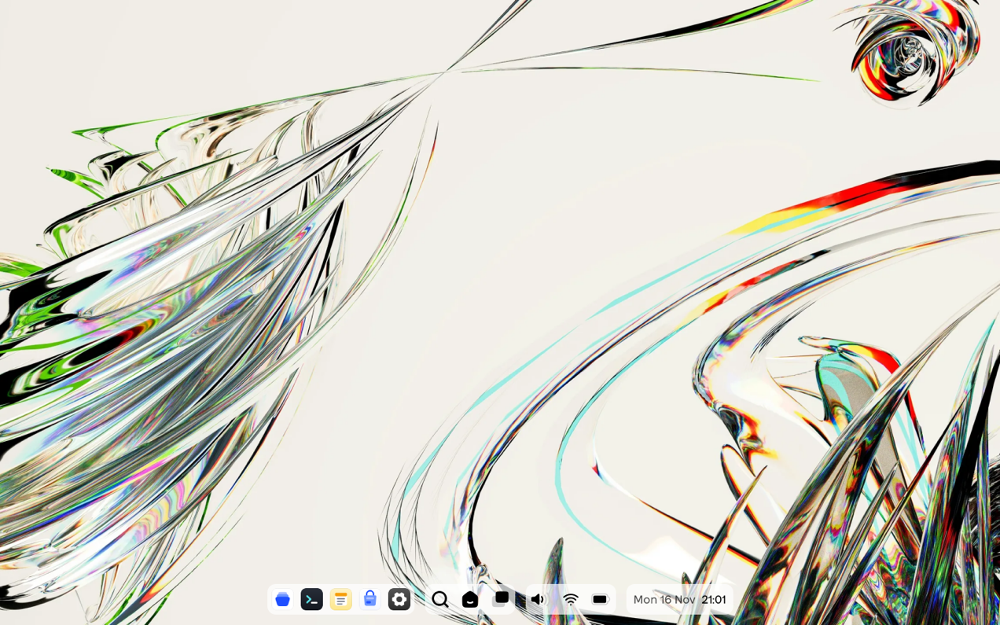

# FinnOS

A modern desktop operating system built on a minimal pacman-based Linux base (`x86_64` and `aarch64`). FinnOS owns its graphical UEFI bootloader (`finn-boot`), silent Plymouth boot splash, Qt 6 Wayland compositor (`finn-comp`), custom-styled C++20 + Qt 6/QML UI framework and SDK (`FinnUI` / `FinnSDK`), adaptive desktop shell (`finn-shell`), offline Recovery Mode installer, first-boot setup (`finn-oobe`), A/B OTA updater (`finn-update`), 11 first-party native applications, and multi-ecosystem compatibility runtimes — while leaving the Linux kernel, systemd, pacman, Mesa, PipeWire, NetworkManager, BlueZ, and hardware firmware intact.



## What is in FinnOS

### Boot, Recovery, Setup & Updates
- **`finn-boot` (`src/boot/`)** — Freestanding C UEFI GOP graphical Startup Manager (`finn-bootx64.efi`, `finn-bootaa64.efi`) implementing the UAPI Boot Loader Specification (Type #1 `/loader/entries/*.conf` + boot-counting, Type #2 Unified Kernel Images), automatic Windows/macOS/Firmware detection, `EFI_LOAD_FILE2_PROTOCOL` multi-initrd handoff, systemd Boot Loader Interface EFI variables, keyboard/pointer UI, and a text fallback (`T`).
- **Silent Boot Chain (`base/`)** — `finnos` Plymouth theme drawing the 72×72 Finn mark on `#0B0E14` with a progress-driven bar from inside the initramfs (`quiet splash vt.global_cursor_default=0 plymouth.ignore-serial-consoles`).
- **FinnOS Recovery Mode (`apps/recovery-mode/`, `src/recovery/`)** — 100% offline graphical installer and repair environment (`finn.recovery` kernel parameter or live ISO boot) with FIPS 180-4 SHA-512 image verification, universal GPT/MBR and UEFI/Legacy BIOS support, non-destructive Windows/Linux dual-boot resize, A/B slot partitioning, data-preserving reinstall, Disk Utility, Bootloader Repair, World Keyboards, Wi-Fi, System Logs, and an embedded POSIX PTY terminal.
- **First-Time Setup (`apps/oobe/`, `tools/finn-oobe-apply`)** — First-boot-only 10-step onboarding (`hi.` intro → Language → Region & Time Zone → Keyboard → Wi-Fi → Account & Hostname → Appearance with 3D pendant lamp → Accessibility → Privacy → Complete) backed by an audited one-shot root provisioning helper.
- **A/B OTA Updates (`src/ota/`, `ota/`)** — `finn-update` / `finn_ota` with pure-Python RFC 8032 Ed25519 manifest verification, resumable HTTP Range downloads, `zstd --patch-from` deltas, `systemd-boot` and `GRUB` A/B slot switching, and `finn-boot-health.service` automatic commit/rollback.

### Display, Shell & UI Framework
- **`finn-comp` (`src/comp/`)** — C++20 / Qt 6 `QWaylandQuickCompositor` serving `/run/finn/wayland-0` (`0660 root:finn`) with `xdg-shell`, `xdg-decoration`, `text-input-v3`, `wp_viewporter`, an 8-layer scene stack, 4 virtual desktops (`WorkspaceModel`), analytic spring animations, CPU backdrop blur + Liquid Glass SDF refraction (`CompositorBackdropItem`), multi-finger trackpad gestures, idle/lock triggers, systemd watchdog, and zero app IDs (`make lint` enforced).
- **`finn-shell` (`src/shell/`)** — Qt Quick desktop shell (`ShellCorona` + `DesktopShell.qml`): 4-pill floating dock with live running-window indicators, Home Menu with folders and recents, Spotlight Search with inline arithmetic, Control Center, receding 3-card Notification stack, workspace Overview, multi-user Lock Screen (`unix_chkpwd` / `su` / `PrepareForSuspend`), and first-boot OOBE launch.
- **`FinnUI` & `FinnSDK` (`src/ui/`, `src/qtplugin/`)** — Shared C++20/Qt 6 libraries `libfinnui` (`FinnSDK::FinnUI`, 29 widget classes) and `libfinnui_qml` (`FinnSDK::FinnUIQml`, 19 AOT-compiled `FinnUI 1.0` QML controls including adaptive `FinnApplicationWindow`), 120 Hz analytic spring physics (`spring.hpp`), `AdaptiveFormFactor` (`Desktop`/`Tablet`/`Mobile`/`TV`), Figma-derived tokens generated from `ui/_tokens.fui`, custom Qt 6 plugins (`libfinnplatformtheme.so`, `libfinnstyle.so`), CMake/pkg-config packaging, `sdk/template`, and the `finn-sdk` CLI.
- **`finn-session` (`src/session/`)** — Unprivileged user broker (`$XDG_RUNTIME_DIR/finn/session.sock`, `0600`, `SO_PEERCRED`) merging native, FinnSDK, Linux `.desktop`/Flatpak/AppImage, Windows, macOS, OpenHarmony, and Android catalogues and launching apps via `posix_spawnp`.

### First-Party Applications (`apps/`)
All 11 user apps in `assets/apps.registry` plus 3 system surfaces (`finn-wallpaper`, `finn-oobe`, `recovery-mode`):

| App | Binary | Highlights |
|---|---|---|
| **Settings** | `finn-settings` | Real hardware/OS probes, Wi-Fi/Bluetooth/Audio/Brightness, display resolution, wallpapers, auto-lock, accounts, compatibility status, guest tools, OTA updates |
| **Finn Files** | `finn-files` | Breadcrumbs, search, copy/cut/paste/rename/delete, `.finnapp` package inspection, persisted folder emblems, open-in-terminal |
| **Finn Terminal** | `finn-terminal` | Native POSIX PTY + VT100/ANSI/CSI/OSC emulator with scrollback and font sizing |
| **Finn Notes** | `finn-notes` | UTF-8 Markdown & plain-text editor with dirty-state tracking and word/line counts |
| **Finn Store** | `finn-store` | Curated catalog, live Flathub API v2 (Flatpak), Aurora/Play FDFE + F-Droid (Android APKs), `winget-pkgs` with SHA-256 (`finn-win`), and local package sideloading |
| **Finn Viewer** | `finn-viewer` | Raster & SVG image viewer with folder gallery, zoom, rotate, flip, and metadata |
| **Finn Monitor** | `finn-monitor` | Live CPU sparkline, memory, load average, uptime, and process management |
| **Finn Calculator** | `finn-calculator` | Standard and scientific calculator with expression history tape |
| **Finn Archive** | `finn-archive` | Browse, extract, and create `.zip` / `.tar*` archives |
| **Finn Capture** | `finn-capture` | Full-screen screenshot capture via compositor IPC with delay and clipboard copy |
| **Flourish** | `finn-flourish` | Optional multi-tab Chromium web browser (`Qt6::WebEngineQuick`) |

### Multi-Ecosystem Compatibility (`src/compat/`, `src/darwin/`, `src/ohos/`, `src/android/`)
- **Linux Apps (runs natively)** — Freedesktop `.desktop` discovery, Flatpak (`.flatpakref`/`.flatpak`/`.flatpakrepo`), AppImage Type 1/2 (FUSE or `--appimage-extract-and-run`), ELF dependency probing, and `.finnapp` bundles. See [docs/linux-app-coverage.md](docs/linux-app-coverage.md).
- **Windows Apps (runs via Wine/Proton/Hangover)** — MZ/PE inspection, `.ico`/`RT_GROUP_ICON` extraction, per-app prefixes, MSI/EXE install planning, `finn-win` CLI, `wl_clamp.c` Wayland shim, and ARM64 Hangover WoW64 helper (`scripts/install-hangover-arm64.sh`). `.msix` is detected and refused. See [docs/windows-app-coverage.md](docs/windows-app-coverage.md).
- **macOS Apps (`finn-darwin`, clean-room partial runtime)** — Native same-arch 64-bit Mach-O/Universal loader, aarch64/x86_64 `objc_msgSend` asm, clean-room `libSystem`/Foundation/CoreGraphics/AppKit-on-Qt6 bridge, minimal SwiftUI slice, and `.app`/`.pkg`/`.zip`/`.dmg` installer. Metal, WebKit, CoreData, Security, and full SwiftUI are not yet implemented. See [docs/darwin-framework-coverage.md](docs/darwin-framework-coverage.md).
- **OpenHarmony 6.1 LTS (`finn-ohos`, clean-room partial runtime)** — Native `.hap`/`.hsp`/`.app` installer, host-ABI NAPI `.so` loader, subset Panda `modules.abc` bytecode VM, and ArkUI-on-Qt6 / static bytecode UI reconstruction. Hardware/distributed system kits (`ArkWeb`, Telephony, Camera, etc.) are unbridged. See [docs/ohos-kit-coverage.md](docs/ohos-kit-coverage.md).
- **Android 17 (`finn-android`, clean-room inspector & layout previewer)** — Native APK/split-APK installer, binary AXML & `resources.arsc` parser, DEX verifier/disassembler, 14-widget AXML-to-Qt6 previewer, and 16-opcode integer micro-interpreter. Does **not** execute full third-party Android apps (no ART/Binder/Zygote/JNI/GMS, and no Waydroid). See [docs/android-coverage.md](docs/android-coverage.md).

## Honest Current Limits

FinnOS follows a strict **"never fake a capability"** rule. Key gaps right now:
- **`finn-comp`**: Xwayland launch is stubbed (`startXwaylandIfEnabled()` does not yet start `Xwayland`); `dual_kawase_blur.frag` is compiled but unused (backdrop blur & Liquid Glass are CPU-rendered); `wlr-layer-shell`, `wlr-screencopy`, `wlr-foreign-toplevel-management`, and `ext-session-lock-v1` are not bound (file-based IPC under `/run/finn/state/` is used instead).
- **`finn-shell`**: `DesktopShell.qml` is implemented; `TabletShell.qml`, `MobileShell.qml`, and `TvShell.qml` are currently empty stubs; there is no `org.freedesktop.Notifications` D-Bus daemon yet; Bluetooth and MPRIS media probes are wired in `Settings`/`OOBE` (`FinnDesktopServices`) but not yet in `ShellCorona`.
- **Sandboxing & Verified Boot**: Native apps run with user `finn` privileges (`linux_sandbox=env-only`; no enforced per-app sandbox). Secure Boot, `dm-verity`, TPM2 sealing, and live hosted `repo.finnos.org` / production OTA signing keys are not yet provisioned.
- **No AI in the tree**: FinnAI is reserved, off by default, and not implemented.

See [docs/architecture.md](docs/architecture.md) and [docs/roadmap.md](docs/roadmap.md) for the full list.

## Build & Verify

FinnOS builds with CMake + Ninja on a pacman-based Linux host or in the Lima/VMware dev VM:

```sh
make                 # session, compositor, Qt6 plugins, FinnUI/FinnUIQml, shell, all apps, tools, compat runtimes
make boot            # freestanding UEFI bootloader (finn-bootx64.efi / finn-bootaa64.efi)
make test            # host Python test suite (base wiring, OOBE, OTA, recovery, icons, release)
make test-unit       # C++20 ASan/UBSan unit tests (compositor, recovery, store, compat, darwin, ohos, android, etc.)
make lint            # diff hygiene, generated tokens check, compositor app-id ban, branding check
sudo make install    # install binaries, Qt6 plugins, FinnSDK, assets, systemd units, and sdk/template
vm/deploy.sh         # sync, build, install, and restart the session on the dev VM
vm/shot.sh out.png   # capture the VM desktop
```

## Write a Native App

```sh
finn-sdk new hello --name "Hello Finn"
finn-sdk build hello
finn-sdk run hello
```

Or target `FinnSDK::FinnUIQml` (`import FinnUI 1.0`, `FinnApplicationWindow`) or `FinnSDK::FinnUI` (`<FinnSDK/FinnSDK.hpp>`) directly with CMake `find_package(FinnSDK REQUIRED)`. See [docs/apps.md](docs/apps.md), [docs/sdk.md](docs/sdk.md), and [sdk/template](sdk/template).

## Documentation

Browse the full index in [docs/README.md](docs/README.md). Key entry points:

- [docs/architecture.md](docs/architecture.md) — processes, Qt 6 compositor, shell, boot chain, compatibility, and honest gaps.
- [docs/code-map.md](docs/code-map.md) — module tour, IPC flows, and where to change what.
- [docs/apps.md](docs/apps.md) & [docs/sdk.md](docs/sdk.md) — writing native Qt 6/QML & C++20 apps with `FinnSDK` and `finn-sdk`.
- [docs/session-protocol.md](docs/session-protocol.md) — exact line-oriented `finn-session` socket protocol.
- [docs/install.md](docs/install.md), [docs/ota.md](docs/ota.md), & [docs/repo.md](docs/repo.md) — offline Recovery Mode installer, A/B OTA updates, and `[finnos]` repo tooling.
- [docs/development.md](docs/development.md), [docs/testing.md](docs/testing.md), & [docs/troubleshooting.md](docs/troubleshooting.md) — dev loop, VM workflow, test suites, and debugging.
- [docs/security.md](docs/security.md), [docs/hardware.md](docs/hardware.md), & [docs/guest-tools.md](docs/guest-tools.md) — authority model, hardware matrix, and VM guest integration.
- [docs/roadmap.md](docs/roadmap.md) — shipped milestones and remaining work.

## Licence

MIT ([LICENSE](LICENSE)) — see [NOTICE](NOTICE) and [CREDITS](CREDITS) for third-party components, fonts, icons, and base system attributions.
