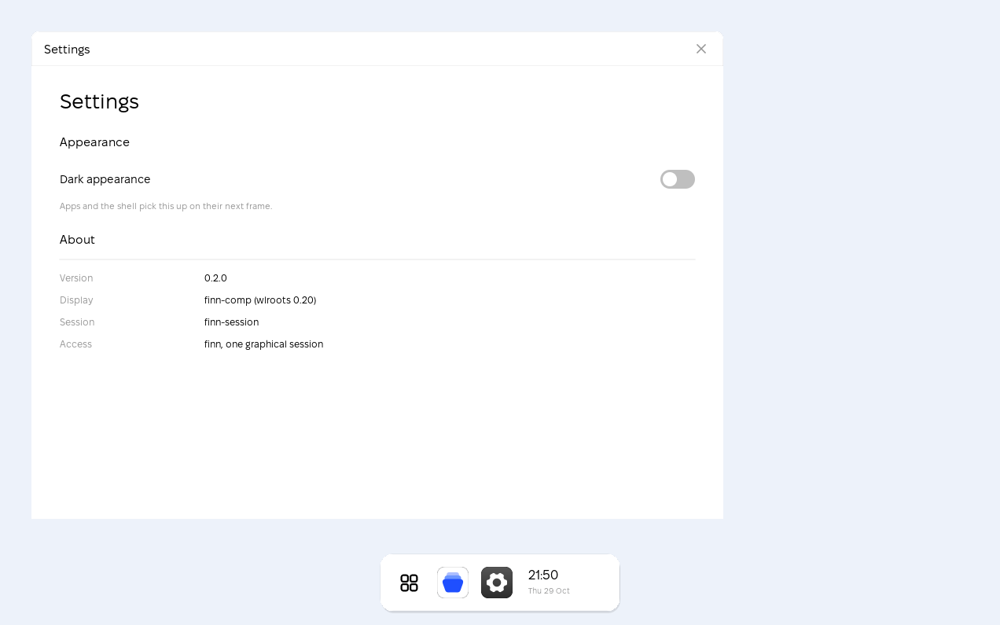

# FinnOS

An operating system for a small, quiet machine: an i3-class laptop or a
handheld, a screen, a pointer, a battery.

FinnOS draws its own desktop. There is no X11, no Wayland and no toolkit
underneath — the compositor owns the DRM scanout buffer, rasterises the
shell itself and page-flips the result. The control plane is one
permissioned unix socket that any script, and any agent, can drive.



## What is here

| | |
|---|---|
| **the compositor** | `finn-comp` — DRM/KMS, a GPU path and a software path, and the shell: the dock, the Control Center, the clock page and the [Start Menu](docs/images/start-menu-light.png) |
| **the control plane** | `finnd` and `finnctl` — one permissioned entry point for state, input, display, power and apps, audited on every call |
| **the registry** | the catalogue of apps the OS ships and the install list the package manager owns |
| **the SDK** | `fuic`, the `.fui` compiler; a Python client; app templates |
| **the adapter** | `finn-mcp` — the control plane as MCP tools, for an agent |

## The rules it is built on

- **Nothing is faked.** A machine with no wireless adapter says so. An app
  that is not installed says so. Every field in the system state has an
  absent value rather than a plausible default.
- **No AI ships.** FinnAI is opt-in, and no model is in the base image.
- **The control plane is off by default**, bound to a unix socket and never
  to TCP, authenticated per connection, and audited.
- **One naming family.** `NAMING.md` is short, and it is the rule.

## Getting it

The build machine is the Arch VM in Parallels: it has the DRM headers, the
GPU stack and the fonts.

```sh
make deploy          # build, install and restart on the VM
make test            # the test suite
```

Then look at it:

```sh
vm/shot.sh /tmp/desktop.png
```

## The tree

```
src/core        the shared library — the protocol, sockets, state, registry
src/compositor  finn-comp: the display server and the shell
src/control     finnd and finnctl
src/pkg         finnpkg
src/tools       host-side tools; they never run on the device
ui              the .fui sources: the shell, the tokens, the targets
apps            the .fui sources of the first-party apps
assets          fonts, wallpaper, the application registry
sdk             FinnSDK
mcp             the MCP adapter
base            the base image: systemd units, packages, setup
vm              the dev VM: install, deploy, capture
docs            the architecture, the protocol, the UI language, the roadmap
tests           the test suite
```

## The documentation

| | |
|---|---|
| [docs/architecture.md](docs/architecture.md) | how the system fits together, and what is not here yet |
| [docs/control-protocol.md](docs/control-protocol.md) | every verb, and the shape of a session |
| [docs/ui-language.md](docs/ui-language.md) | `.fui`, the tokens and the targets |
| [docs/development.md](docs/development.md) | the dev loop, the VM, the tools |
| [docs/roadmap.md](docs/roadmap.md) | what comes next |
| [sdk/README.md](sdk/README.md) | FinnSDK: the compiler, the client, the templates |
| [NAMING.md](NAMING.md) | the naming rules |
| [AGENTS.md](AGENTS.md) | how to work in this tree |

## Licence

MIT. See [LICENSE](LICENSE).
