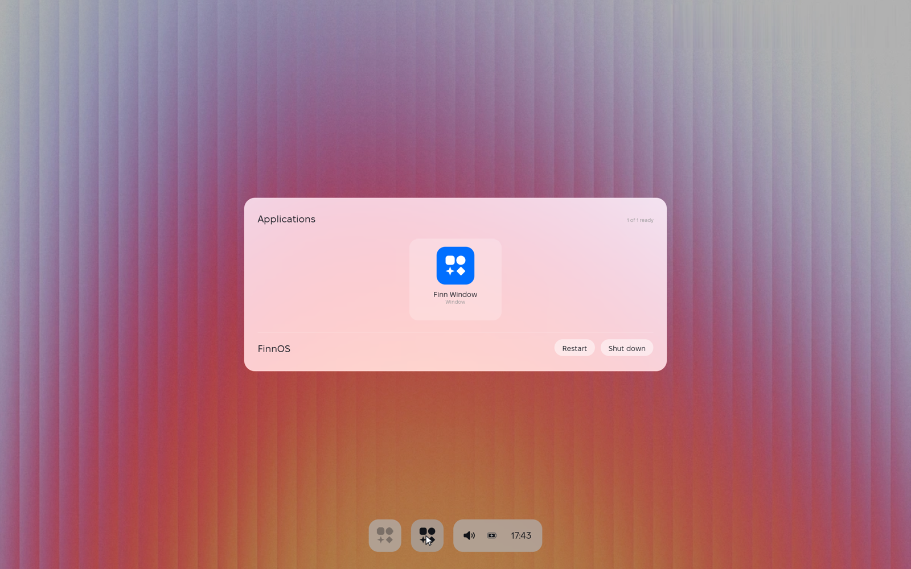

# The architecture of FinnOS

FinnOS is an operating system for a small, quiet machine: an i3-class laptop
or a handheld, a screen, a pointer, a battery. It is built around a few
decisions that everything else follows from.

- **The compositor owns the display.** Direct DRM/KMS, page flips, no X11,
  no Wayland, no toolkit. The shell is drawn by the same process that owns
  the scanout buffer.
- **The control plane owns the authority.** One permissioned entry point for
  state, input, display, power and apps. It is off by default, it is a unix
  socket and never TCP, and every call is audited.
- **Nothing is faked.** A machine with no wireless adapter says so. An app
  that is not installed says so. Every field in the system state has an
  "absent" value rather than a plausible default.
- **No AI ships.** FinnAI is opt-in, and no model is in the base image.


## The processes

There are two, and that is the whole system.

```
                    ┌──────────────────────────────────────┐
   script, agent    │  finnd — the control plane           │
   or the shell  ──▶│  /run/finn/control.sock   (0660)      │
                    │  root and the finn group only        │
                    │  every call is logged with its peer  │
                    └───────────────┬──────────────────────┘
                                    │ proxies the verbs it does
                                    │ not own: display, input,
                                    │ sound, appearance, notify
                    ┌───────────────▼──────────────────────┐
                    │  finn-comp — the compositor           │
                    │  /run/finn/comp.sock                 │
                    │  owns the scanout buffer and the     │
                    │  pointer, and draws the shell        │
                    └──────────────────────────────────────┘
```

`finnd` is the API. It handles the verbs that must keep working when the
compositor restarts — state, power, apps — and proxies the rest to
`finn-comp`, which is the only thing that can move the pointer or read the
framebuffer.

The shell is not a third process. The dock, the Control Center, the clock
page and the Start Menu are *surfaces*: they are rasterised into cached
layers and composited into the same frame as the wallpaper, so a surface
costs a blit rather than a round trip over a socket. That is a deliberate
trade: one process does more, and the desktop never waits for itself.

### The binaries

| Binary | What it is |
|---|---|
| `finn-comp` | the compositor: DRM/KMS, the wallpaper, the shell surfaces |
| `finnd` | the control plane: the one permissioned entry point |
| `finnctl` | the control-plane client; every verb is scriptable |
| `finnpkg` | the package manager and the OTA frontend |
| `finn-mcp` | the MCP adapter — it runs on the *host*, not the device |

`finn-mcp` is deliberately not part of the operating system. MCP is a
transport, not the OS API: it lives outside the device, and the device
speaks a small line protocol that any shell can drive.

## The tree

```
src/core        the shared library — data and plumbing only
src/compositor  finn-comp: the display server and the shell
src/control     finnd and finnctl
src/pkg         finnpkg
src/tools       host-side tools; they never run on the device
ui              the .fui sources: the shell, the tokens, the targets
apps            the .fui sources of the first-party apps
assets          fonts, wallpaper, the application registry
mcp             the MCP adapter
sdk             FinnSDK: the compiler, the client library, the templates
base            the base image: systemd units, packages, setup
vm              the dev VM: install, deploy, capture
docs            this, and the protocol and the UI language
tests           the test suite
```

The rule the split follows: **the core knows nothing about the compositor
or the control plane, and neither of them knows about the other.** The one
thing that crosses the line is the protocol, and the protocol is one header
(`src/core/finnproto.h`).

## The compositor

```
finn-comp.c      DRM/KMS, the wallpaper, composition, page flips
finnvg           the vector rasteriser for the icon set
finntext         Fixel Display, through FreeType
finndraw         the shared drawing primitives and the palette
finnblur         the blurred wallpaper the frosted surfaces sample
finnanim         the animation tracks
finnpointer      evdev pointer and the cursor sprite
finngpu          GBM/EGL/GLES2 compositing, when the machine has it
finnnotify       the shell's notification queue
finnboot         the boot screen: the mark and the progress line
finnsetup        the first-boot setup screen (language, appearance, start)
finndock         the dock (taskbar bubble, launcher bubble, system tray pill)
finncontrol      the Control Center
finnclock        the Notification Center and clock page
finnmenu         the Start Menu
finnwindow       frosted windows and first-party app views
```

### Two backends, one frame

The compositor has a software path and an accelerated path, and it picks
between them by probing rather than by assuming. GBM and EGL are opened, the
config is matched against the scanout format, and a machine that cannot
give back a scanout-capable buffer lands on the software path with nothing
else changed.

Both paths compose the same surfaces, in the same order, from the same
cached layers. The difference is that the software path memcpy's the layers
into a dumb buffer while the accelerated path pastes them as quads.

### Frames are earned, not scheduled

Nothing here runs on a timer. A frame is composed when something actually
changed: the wallpaper is decoded once, the dock is rasterised only when
its state moves, the cursor is composited over a cached base, and an
untouched desktop redraws nothing at all. The page flip is the clock — the
next frame is due when the last one has landed.

The animation tracks are the one thing that shortens the poll, and only
while they are moving. When the last track settles, the compositor is back
to blocking on input with zero redraws.

### The shell surfaces

All surfaces are drawn in the same language: the same frosted glass,
the same corner radii, the same type scale, the same motion. They are
rasterised into transparent layers, and the compositor blits them.

| Surface | Anchored to | Opens from |
|---|---|---|
| the boot screen (`finnboot`) | centered on `#000000` | compositor wake-up |
| the setup screen (`finnsetup`) | full screen | first boot or `setup.show` |
| the dock (`finndock`) | the bottom of the screen | always there |
| the Control Center (`finncontrol`) | the tray pill | the tray's status block |
| the Notification Center (`finnclock`) | the clock | the clock itself |
| the Start Menu (`finnmenu`) | the middle of the screen | the dock's middle launcher button |
| windows (`finnwindow`) | free-floating on the desktop | the dock's left taskbar button, the Start Menu, or `window.open` |

The Start Menu is the one surface that is not anchored to a control: it is
the system's front door, so it stands in the middle of the room and the
desktop dims behind it.



## The control plane

`finnd` is root-equivalent authority over a running system. It can move the
pointer, read the framebuffer, start programs and power the machine off.
That is why it is:

- **off by default**, on the same intent as the zero-AI rule;
- bound to a **unix socket only** — there is no TCP listener, ever;
- **authenticated per connection** with `SO_PEERCRED`: root, or the `finn`
  user;
- **audited** to `/var/log/finn/control.log`, with the peer uid on every
  call;
- run under systemd hardening.

The socket belongs to root and to the `finn` group, and to nobody else.
The daemon runs in root's own group on purpose: systemd takes `CAP_SETUID`
away from a service whose group it had to change, and the control plane
needs that capability to start an app as the user rather than as root. The
group is therefore set on the socket itself, which is where it matters.

An app is started by systemd, as the user, in its own transient unit. The
control plane asks systemd to do it rather than doing it itself, because
the daemon is hardened with `NoNewPrivileges` and does not hold
`CAP_SETUID` — and because an app that systemd started is an app systemd
knows about, logs and cleans up.

The protocol is documented in [control-protocol.md](control-protocol.md).

## The application registry

Two files, two owners:

| File | Owner | Says |
|---|---|---|
| `/usr/share/finn/apps.registry` | the OS | which apps exist, what they are called |
| `/var/lib/finnpkg/installed` | the package manager | which of them are on this machine |

Keeping them apart is what lets the shell show an app that is honestly
"not installed" without the package manager having to edit a file the OS
ships — and it keeps a catalogue update from wiping the user's install
list.

The catalogue is the whole family of first-party apps. The shell draws
what it finds there, and the control plane launches what the install list
says is there.

## The UI language

`.fui` is the source language of the interface: a screen, its tokens and
its adaptive targets. It is described in [ui-language.md](ui-language.md).
`fuic`, the compiler, is part of [FinnSDK](../sdk/README.md).

## What is not here yet

Honesty is a property of the documentation too. These are the parts of the
system that do not exist yet, stated plainly so that nobody looks for
them:

- **No external client surface protocol.** `finnwindow` manages frosted
  desktop windows (`window.open`, `window.list`, `window.close`,
  `window.minimize`, `window.maximize`, `window.move`) and draws the
  compositor's built-in views, but an external process started by
  `app.launch` cannot yet stream its own pixel buffer over a socket.
- **No keyboard input.** The compositor reads a pointer and nothing else.
  The `key.*` verbs are reserved.
- **No OTA.** `finnpkg update` is a stub, and the A/B slots are a design
  in [roadmap.md](roadmap.md), not a feature.
- **No FinnAI.** It is off by default and there are no weights in the base
  image. That is the intent, not an omission.
