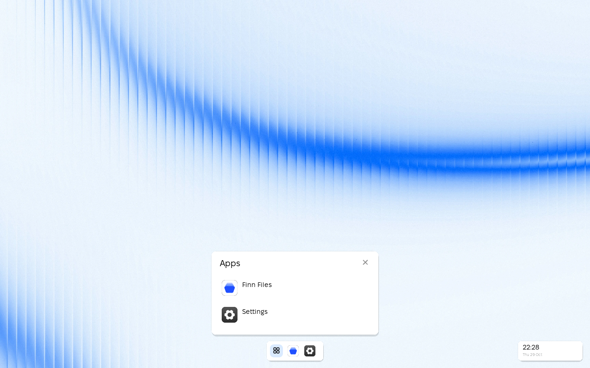

# Design source

The design lives in the Figma file **FinnOS**, page **FinnOS - Desktop**.
The frames used by the implementation are:

| Frame | Node | What it fixes |
|---|---|---|
| Desktop | `186:4253` | wallpaper, dock, status, window |
| Empty Window | `186:4039` | window chrome and the empty state |
| Desktop - Control Center | `218:24` | the future panel |
| Desktop - Home | `186:4172` | the app menu |
| Settings | `186:3863` | the settings surface |
| Boot | `186:4294` | the bootstrap mark |

## Measurements taken from the file

- Dock and status pills: 42 px high, 8 px radius, fill `#FFFFFFA6`, 15 px
  background blur via `Canvas::glass`, task icons 26 px, taskbar 115 × 42,
  left-center dock 116 × 42, time pill 139 × 42, and status dock 116 × 42.
- Window: 8 px radius, white, 15 px blur and a 4 px offset shadow; the window
  options are a 72 × 24 `#F9F9F9` pill.
- Type: Fixel Display. Status clock is drawn at 16 px Fixel Display Regular
  matching SPEC.md. Weather metrics are omitted because there is no live weather
  data source in v1.
- Panels:
  - App Menu (`186:4172` and `218:107`): 800 × 500 glass panel with Right Panel
    (385 × 480), Account Options with real login user from `getpwuid`, and
    scrollable All Apps view supporting mouse wheel input.
  - Control Center (`218:24`): 405 × 500 glass panel opened from the status dock.
    Features a working Dark/Light appearance toggle that writes user settings.
    Controls without system daemons (Wi-Fi, Bluetooth, brightness, volume) are
    drawn disabled and dimmed without fake metrics.

The implementation keeps the geometry, palette tokens, and typography matching
the Figma design specification. [docs/motion.md](motion.md) records the motion
translation.



## Figwright

The Figma file is reachable through the [Figwright](https://github.com/awdr74100/figwright)
MCP server and its Figma plugin. The server is added to Command Code as:

```json
{
  "mcpServers": {
    "figwright": {
      "transport": "stdio",
      "command": "npx",
      "args": ["-y", "@figwright/mcp@latest"]
    }
  }
}
```

Use the absolute path to `npx` when Node is managed by a version manager
(fnm, nvm, asdf, volta, mise); the MCP client does not run a login shell.

The plugin must be open in the same Figma app; the relay is local
(`127.0.0.1:3055`). Useful tools:

- `list_files` / `use_file` — claim the open FinnOS file.
- `get_design_context` — measurements, tokens and layout; prefer it over a
  screenshot for values.
- `save_screenshots` / `get_screenshot` — a visual check.
- `get_motion_styles` / `get_node_motion` — motion presets and timelines.

The file has no baked Figma Motion timelines. Its presets are `Position`,
`Scale` and `Opacity` with `OUT_CUBIC`; the implementation uses those curves
with shorter durations, as [motion.md](motion.md) explains.
