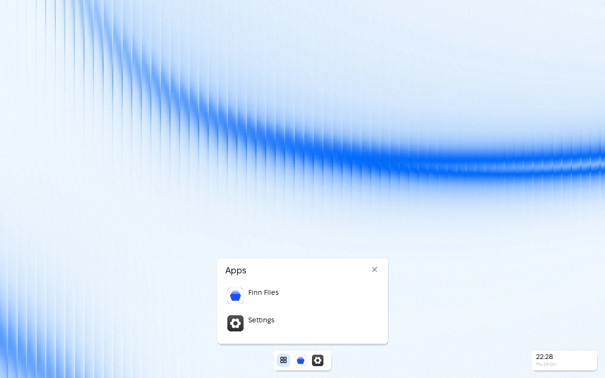

# Design source

The unified FinnOS design language lives in
[`docs/design-language.md`](design-language.md); the component inventory and
node-by-node audit of the **FinnOS - Abhi** Figma file live in
[`docs/figma-inventory.md`](figma-inventory.md) and
[`docs/figma-audit.md`](figma-audit.md).

In the current **FinnOS - Abhi** Figma file (across **Cover**, **Pointers**,
**Notifications**, **First Time Setup**, **Desktop**, and **Settings App**;
**Colors** and **Text Styles** are currently empty), the primary desktop and
OOBE frames are:

| Frame | Node | What it fixes |
|---|---|---|
| Desktop | `2:285` | wallpaper, 4-pill glass dock (`4:58`) |
| Search (Spotlight) | `4:226` | `300×44` search pill (`5:16`) + `350×228` recommendations (`5:2`) |
| Home (App Menu) | `4:24` | `585×460` Home panel (`4:60`) |
| Control Center | `11:19` / `11:216` | panel `444×300` at `(575, 458)` in a `1280×832` frame — right edge on the dock group's right edge, `74 px` above the bottom |
| Settings - About | `20:64` / `20:98` | `800×500` split window, `250 px` sidebar (`21:131`), `88×28` window controls (`20:106`), hardware cards (`25:136..25:170`), and `OS Info` (`25:145`) |
| Notifications | `2:169` | `340×80` `r=20` notification card (`2:168`, `2:170`, `2:178`, `2:255`) |
| Pointers | `2:7` | 9 `28×28` cursor variants (`2:6..2:144`) |
| First Time Setup - `hi` | `36:3` | `#F5F5F5` OOBE canvas, top `Branding` (`36:45`), cursive `"hi."` (`36:37`), `56×56` Next circle button (`36:48`) |
| First Time Setup - `How do we talk?` | `36:53` | split prompt (`x=225, y=365`) + `350×648` `Languages` list (`37:96`) with progressive bottom blur (`y=0.607..1.0`) and `132×56` Back/Next controls (`36:70`) |

*(Historical node IDs from earlier iterations — `186:4039`, `218:24`, `186:4172`, `218:107`, `186:3863`, `186:4294` — are no longer present in `FinnOS - Abhi`.)*

## Measurements taken from the file

- Dock and status pills: `44 px` high, `12 px` radius (`0.6` smoothing in Figma),
  translucent `glass` surface (`#FFFFFF@70%` in Figma; tokenized `bone`/`glass`
  in `ui/_tokens.fui`), `32×32` (`r=8`) app tiles, `130 px` Home/Hardware pills,
  `154 px` Time pill, `15 px` gaps.
- Window: `12 px` radius (`FinnWindow` `kRadiusXl`), tokenized `bone`/`tile`
  canvas, crisp `1 px` `hair` border; `FinnWindowControls` draws the `88×28`
  (`r=6`, matching `20:106`) window controls pill (Maximize/Restore, Minimize,
  Close).
- Typography: `Fixel Display` for UI and display sizes, bundled monospace for
  code and terminal views.
- Panels:
  - Home / App Menu (`4:24` / `4:60`): glass panel with favorites, All Apps
    categories, account identity (`getpwuid`), and quick launch.
  - Control Center (`11:19` / `11:216`): appearance toggle (Light / Dark) plus
    honest NetworkManager, BlueZ, PipeWire audio, and UPower power/battery tiles.
  - Spotlight Search (`4:226` / `5:16` + `5:2`): instant filtering across
    installed apps, XDG `.desktop` entries, Wine prefixes, files, and arithmetic
    expression evaluation.

All canonical tokens derive from [`ui/_tokens.fui`](../ui/_tokens.fui) (the
single source compiled into `src/ui/generated_tokens.hpp`), documented in
[`docs/design-language.md`](design-language.md). There is no
`assets/figma/SPEC.md` in this tree. See [`docs/motion.md`](motion.md) and
[`docs/motion-spec.md`](motion-spec.md) for animation timings and springs.

## The desktop wallpaper

`assets/wallpaper/default.webp` is the 4,096×2,304 image fill exported from the
Figma **Desktop** frame (`2:285`) — the same artwork the Settings (`20:64`) and
Control Center (`11:19`) frames use — and resized to 2560×1440. The old default
was a purple-to-red gradient blob; it left no calm space for the dock or for
window text. `assets/wallpaper/setup.webp` stays as the first-boot wallpaper.

## Recovery mode

Recovery (`recovery-mode`) has no Figma frame of its own, so it reuses the
exact OOBE split layout, typography, progressive list blur, circular chevron
navigation, and sequential slide+blur transition engine from `apps/oobe/main.cpp`
(with no top-left branding header on split pages). It keeps the same one-accent /
one-neutral rule and never imitates another operating system's recovery chrome.

## One accent, one neutral

The sidebars use the accent (`on_light`/`on_dark`) only for the current or live
row and the neutral (`mute_light`/`mute_dark`) everywhere else. A folder, a
source or a file type is named by its HugeIcons glyph and its metadata, not by a
colour: six saturated badges meant that nothing stood out. Every glyph used by
these rows already exists in `assets/icons/` as a single-colour HugeIcons-style
SVG that `FinnThemeManager` tints like the rest. The hero card keeps the one
tinted surface (`hero_tint`) but no hue gradient,
and Recovery keeps a single neutral surface instead of a three-stop gradient.

## Figwright

When inspecting Figma locally with Figwright (`127.0.0.1:3055`),
`list_files` / `use_file` / `get_design_context` / `get_screenshot` can pull
updated Figma tokens and layouts into `ui/_tokens.fui`.
